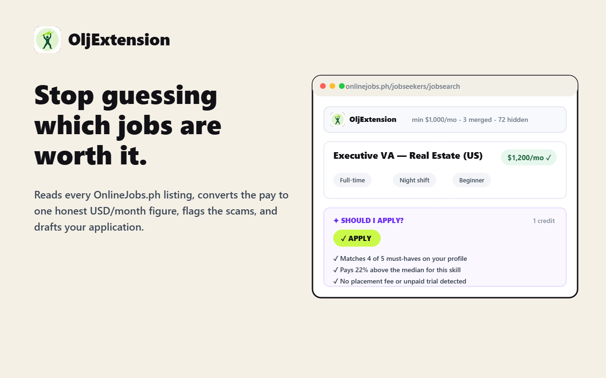

# OljExtension

[](LICENSE)


OljExtension is a Chrome extension for job seekers on
[OnlineJobs.ph](https://www.onlinejobs.ph). It reads each listing's salary
field and converts it to one comparable figure, US dollars per month. Listings
below your threshold collapse to a single grey line. It also flags costly terms
and scam signals, and tracks your applications. It can optionally draft a first
message to the employer.

> Not affiliated with, endorsed by, or sponsored by OnlineJobs.ph. The extension
> only reads pages you already have open on the site. It never submits an
> application or presses Apply for you.



## At a glance

**Free, and everything stays in your browser**

- **Rate filter.** Converts hourly, daily, weekly, and monthly rates in PHP,
  USD, AUD, CAD, GBP, and EUR into USD/month, then hides what pays too little.
  A rate it can't read is never hidden.
- **Better search.** Merges several result pages into one, searches several
  keywords at once, sorts by rate or date, and filters with a skill cloud.
  Also has saved searches, presets, and a command palette.
- **Signals.** Flags red-flag terms that cost the applicant, reposted and
  duplicate jobs, new or censored employer accounts, and whether a job suits
  beginners. Shows how a rate compares to what you've seen.
- **Tracking.** Applied / Interviewing / Offer / Rejected stages, a kanban
  board, follow-up reminders, an application funnel, job notes and tags, and
  employer notes and blocks.
- **Alerts.** Opt-in background checks of your saved searches, shown as a
  toolbar badge.
- **Backup.** Export and restore everything as one file, or copy listings
  straight into a spreadsheet.

**Optional, with an account on [oljextension.site](https://oljextension.site)**

- **AI application drafts** and **job analysis**, paid for with credits. These
  are the only features that send anything off your machine. Nothing is sent
  until you press the button, and the first press shows exactly what will be
  sent. Your email and phone number are never included.

## Contents

- [Install](#install) · [Development](#development) · [Using it](#using-it)
- [Applying](#applying) · [What it never does](#what-it-never-does)
- [Architecture](#architecture) · [Tests](#tests)
- [When the site changes its markup](#when-the-site-changes-its-markup)
- [License](#license)

## The one rule that shapes everything

**A listing is only hidden when its rate could be turned into a monthly figure**
— either read outright, or inferred by a bounded, switchable assumption. When
nothing usable can be established, the listing stays visible.

A parser gap should cost you a little scrolling, never a job you never saw.
Every other filter is opt-in; only the rate threshold is on by default.

## Install

```bash
npm install
npm run build      # builds the React options page into dist/options/
```

Then in Chrome:

1. `chrome://extensions` → enable **Developer mode**
2. **Load unpacked** → select this folder
3. Open the job search page

`npm run build` must have run at least once — the options page is a built
artifact. The filtering logic itself is plain ES modules and needs no build.

The unpacked extension (this folder) points its account features at a local dev
server on `http://localhost:3100`. The store build changes that to
`https://oljextension.site` and removes the localhost permissions. Everything
that works without an account behaves the same in both.

## Development

| Script | What it does |
|---|---|
| `npm run build` | Builds the React options page into `dist/options/` |
| `npm run dev` | Vite dev server for the options page |
| `npm test` | Unit and jsdom integration tests (Vitest) |
| `npm run test:watch` | Tests in watch mode |
| `npm run test:e2e` | Drives a real Chrome over CDP. Needs Chrome on `OJRF_CDP` (default `http://127.0.0.1:9222`) with the extension loaded |
| `npm run package` | Builds the Chrome Web Store zip, pointed at production |

Requires Node.js 20 or later.

## Using it

A control strip appears above the results:

```
RATE   [ min $ 2000 /mo ]   +150 merged   61 of 180 hidden   59 low rate · 35 assumed   ⚙
SEARCH (engineer ×) (developer ×)  [ engineer, full stack, developer… ]
```

There is no on/off switch in the bar. The extension exists to filter rates, so a
button undoing that is self-defeating; the master switch lives in settings as an
escape hatch for comparing against the untouched page. There is no slider either
— the number field is the control, and the space goes to the counts instead.

The cog opens the full React options page. Skills and job types live in the
sidebar (see below); the job-type pills mirror the site's own chips, labelled and
ordered exactly as it labels them — click one to hide that type; it greys out and
strikes through.

All four are real categories. Counted over the sweep: **Full Time 145, Part Time
53, Any 47, Gig 8**. "Any" means the employer stated no arrangement, which the
pill's tooltip says, since as a bare label it could be misread as "show
anything".

⚠️ One subtlety: **"Any" and "Gig" share a CSS class** (`badge any`) — only the
chip's text distinguishes them. Detecting by class would silently fold all 8 Gig
listings into Any, so [find-listings.js](src/content/find-listings.js) reads the
label text instead.

Each listing gets a meta row on its second line — three chips with icons:

```
Property Management Operations Assistant | Australian Real Estate
🕐 3m ago    💲 ~$600/mo    💼 Full Time
```

The **date** is relative rather than `Posted on 2026-08-17 16:07:49`, with the
exact stamp in its tooltip; the **rate** is the normalized figure, its tooltip
showing what the listing actually said; the **type** is the job type. The site's
raw date text, its rate line and its duplicate job-type chip are hidden, so each
fact appears once. The description excerpt is shown by default. All of it is
reversible from **Display**.

Hidden listings are gathered into one collapsible block — `▸ 16 LISTINGS HIDDEN`
— so the listings still worth reading stay contiguous instead of being broken up
by stubs. Open the block to see them, or expand any single one with `show`. The
block can sit at the top, at the bottom, or be switched off so each stub stays
where its listing was.

Only our own stubs move. The hidden listing itself stays exactly where the site
put it, which is what keeps "switch the filter off and the page is untouched"
true by construction.

| Setting | Default | What it does |
|---|---|---|
| Hide below | `$500/mo` | The threshold, in USD per month |
| Exchange rates | `61 PHP`, `1.4 AUD`, `1.39 CAD`, `0.74 GBP`, `0.86 EUR` = $1 | Manual by design — no network calls, nothing to rot |
| Hours per month | `160` | Converts hourly rates to monthly |
| Days per month | `22` | Converts daily rates to monthly |
| Range basis | high end | `$300-$500` is judged as `$500` — forgiving on purpose |
| Range display | high end | What the badge prints: the high end, the low end, or `$300–$500/mo` |
| Assume monthly | on, above `$100` | Most listings state an amount with no period (see below) |
| Meta row | on | `$520/mo` read, `~$520/mo` assumed, `per-task` piecework |
| Hide the site's rate line | on | The chip already states it, converted |
| Show the description excerpt | on | Off makes the results list compact |
| Merge further pages | `5` | ~150 listings to filter in one pass |
| Hidden listings | gathered at top | Or at the bottom, or left in place |
| Full window width | on | Only the results section; header and footer untouched |
| Sidebar width | `330px` | Adjustable 220–640 |

### The other filters

All off by default. The control bar always breaks down which rule hid what
(`12 of 30 hidden - 1 low rate, 7 no rate, 3 job type`), and every collapsed
stub says its own reason.

| Filter | What it catches |
|---|---|
| Hide listings with no rate at all | `TBD`, `TBA`, `Negotiable`, empty field |
| Hide listings whose rate we could not read | bare `800` with no currency, `$6-$12` with no period |
| Hide per-task and fixed-price work | `$1-$5 per approved comment`, `$10 per 100 images`, `$6/lead`, `$150 fixed price` |
| Hide job types | Full Time · Part Time · Any · Gig (also pills in the bar) |
| Hide older than *N* days | read from each listing's posting timestamp |
| Hide titles containing… | comma-separated, case-insensitive, title only |
| Keep only listings matching… | title + skill chips, matched in the page (the skill cloud writes here) |
| Search terms | double as a filter — anything unrelated is hidden as `not in search` |

**Per-task detection** works by rule, not by keyword list: anything after `per`
or `/` that is not a time unit means the pay is per unit of work. The word
boundary on `per` matters — without it the check fires on the "per" inside
*"experience"*, which appears constantly on this site.

Non-rate filters are evaluated before the rate filter, because they rest on
facts the page states outright rather than on a parse. That order also decides
which reason you see when more than one rule applies.

### Calibration

The parser is tuned against a sweep of **1,752 live listings across 60 pages and
12 queries — 1,007 distinct rate strings**. There is no house style; the field is
free text:

```
4USD/hour        PHP 20-25K        $150 AUD fixed price      TBD
$700/mo          Starts at 30k PHP+ per month                we need to talk
42,000           AUD $10 to $15 per month        $1-$5 per approved comment
$1,000–$1,500 p/m (paid every two weeks)      32 hours = 11-12,000 PHP per month
```

Current results over that population:

| | listings | |
|---|---|---|
| Read outright | 721 | period and currency both stated |
| Assumed | 697 | one of them inferred (badged `~`) |
| Per-task | 56 | piecework, not a salary |
| No rate given | 271 | empty field, `TBD`, `Negotiable` |
| Unhandled, kept | **7** | genuinely ambiguous |
| **Judged** | **1,418 / 1,752 (81%)** | |

The seven leftovers are things a person could not confidently read either:
`225$ plus bonuses 5.63 hr`, `PHP 3,000 (Paid Trial) + PHP 8,000/month`, `0`.

### Reading what the listing does not say

Most listings state an amount but leave the period, the currency, or both
implicit. Refusing to judge them all would cost most of the filter's usefulness,
so three assumptions fill the gaps — each bounded, each switchable.

**Period** — one split point, two readings. At or above `$100` the figure is
monthly; below it, hourly. `$600/hour` would be $96,000 a month, and `$5/month`
is nobody's salary, so a single number separates them. A bare `5` becomes
$800/month.

The hourly reading is bounded above by **$30/hour**, which is the platform's own
cap for applicants — so an assumed rate above it is impossible rather than merely
unlikely. A bare `60.00` read as hourly claimed $9,600 a month; now anything
between the two readings (too small for a month's pay, too large for an hour of
it) is left unresolved, and therefore stays visible. A rate the employer *states*
is always taken at face value: `$60/hour` really is $9,600 a month.

**Gigs** are exempt from the period assumption entirely. A gig is one piece of
work for one fee, so a bare `60.00` on a gig means $60 for the job — it is
reported as `$60 fixed` rather than converted to anything monthly.

**Currency** — also split by magnitude. Up to `10,000` the figure is dollars,
this site's convention; above that it is pesos. `42,000` was the commonest bare
amount in the sweep, appearing ten times, and every instance was a peso salary.

**Plausibility** — any assumption landing above `$10,000/month` was the wrong
assumption and is discarded, leaving the listing visible. `$80 USD` read as
hourly would claim $12,800 a month. Rates the listing *states* are never capped:
`$75/hr` really is $12,000 a month.

Three things block assuming altogether:

- **A period word we saw but could not attach.** `225$ plus bonuses 5.63 hr`
  mentions an hour, so the 225 is never called monthly.
- **Per-task rates.** `$1-$5 per approved comment` is not a salary.
- **A non-positive amount.**

A bare `$` is taken as USD; an explicit currency word near the amount overrides
it, including when the word precedes the symbol (`AUD $10 to $15`).

**Six currencies** are handled: USD, PHP, AUD, CAD, GBP and EUR, each with its
own manually-set rate. The last three came out of a 102-page sweep of 1,403
distinct rate strings, which found 14 Canadian, 4 British and 3 euro. Small
numbers, but not a cosmetic gap: written with a dollar sign, `CAD $900` and
`$650/month CAD` were being read as US dollars and **overstating the pay by about
a third**. Currencies that never appeared — SGD, NZD, HKD, INR, JPY and the rest
— are deliberately not handled.

The options page includes a **parser tester**: paste any salary text and see the
amount, currency, period, converted value, and the hide/keep verdict with its
reason. That is the fastest way to check a listing that looks wrongly filtered.

## Hours, and what an hourly rate really pays

An hourly rate only becomes a monthly figure once you know how many hours. The
extension used a fixed 160 a month for every listing, so:

```
"$5/hour, 20 hrs/week"   reported as $800/mo   actually pays $433
```

That is not cosmetic. At a $500 threshold it *promoted* that part-time listing
over full-time work paying more — the opposite of what the filter is for. The
listing's own stated hours are used when it gives them, and the setting only as
a fallback.

Where those hours live matters: the results card states them on roughly **1 in
30** listings, the job page nearly always. So this earns most of its value in
the modal and on the job page, both of which now pass the stated hours into the
conversion.

A monthly rate is unaffected — hours do not change what is quoted — but the
effective hourly is computed for those too, since it is the only fair way to
compare $800 for 40 hours against $700 for 20. Both appear in the badge tooltip,
because the same "$5/hr" is $867 or $433 depending on an assumption you would
otherwise have no way to see.

## Terms that cost the applicant

Every other rule here optimises: is this enough money, is it the right kind of
work. These protect. Six phrases, most serious first — **asks for money**
(placement or registration fees), unpaid trial, unpaid training, commission
only, paid in exposure, and being moved to Telegram or WhatsApp before hiring.

Conservative on purpose, because a false positive tells someone a real job is a
scam:

| flags | does not flag |
|---|---|
| `commission only` | `$1,200 base plus commission` |
| `unpaid training` | `paid training` |
| `message me on Telegram to apply` | `manage our Telegram channel` |

The tests assert the non-matches as carefully as the matches. Flagged rather
than hidden by default — a warning you can overrule is useful, a listing removed
without explanation teaches you nothing — and hiding them is one toggle away.

Run against the full description in the modal and on the job page. The results
card only ever holds an excerpt, so that is where a flag is actually found.

## Marking your own terms

Your search keywords and required skills are highlighted wherever they appear,
so you can see *why* a listing matched.

Painted with the **CSS Custom Highlight API**, not by wrapping matches in
`<mark>`. Wrapping means splitting the site's own text nodes and stitching them
back on restore — exactly the edit this extension avoids making to a page it
does not own. The ranges live outside the DOM: nothing inserted, nothing split,
and a test asserts `innerHTML` is unchanged after painting.

## How long a job has been going round

`employers.js` catches the same role posted twice on one page. This catches the
employer posting it again every month — a role advertised since March is one
that everybody who applied turned down or left.

Reposts get new URLs, so a job key cannot follow them; the signature is the
employer and title with pay discounted, the same one used within a page. Silent
until three weeks, then `advertised 6 weeks`.

**Dates only.** The store holds a first-seen and last-seen timestamp against
that signature and nothing else — no titles, no employer names, no links. A test
asserts none of those reach storage, because "we remember what you have seen" is
a claim that deserves checking rather than trusting.

## What the job page says about the employer

Read only from a page you opened yourself — the modal's fetched document, or the
job page you are standing on. Never by opening pages on its own: mining an
employer block per listing is exactly the crawling pattern that gets an account
flagged.

- **A new account**, stated as a fact with a date and the number of jobs they
  have ever posted. Everyone is new once; it is the pairing with an unusually
  high rate that matters, and that is left to you.
- **A post with its contact details blurred**, which the site does to employers
  without a paid account.

That second one is a cautionary tale. It was first matched on the words *"Why is
this blurred?"* — and the site ships that explainer in the markup of **every**
job page, rendering it only for free accounts. So it fired on a paid posting
whose email and links were plainly visible: the worst kind of false positive,
one that accuses a legitimate employer. It is decided by layout now, and a
`DOMParser` document has no layout, so the modal says nothing rather than
guessing.

## Searching several things at once

The site searches one phrase at a time. Type `engineer, developer` in the bar's
**Search** row — each comma turns the text into a removable pill — and both
searches run together, their results merged and deduplicated into one list.

Measured live with two terms: **+111 listings merged, 141 total, all unique.**

Search terms are also a *filter*, not just a fetch. Without that the page's own
unrelated listings would sit above the results and it would look as though
searching did nothing; they are hidden with the reason `not in search`. Matching
is against the whole card, because the site searches descriptions too — a job
titled "AI/Integrations Specialist" is a legitimate hit for `engineer`.

The request mirrors the site's own form, including `gig`/`partTime`/`fullTime`
and `isFromJobsearchForm=1`. `skill_tags` is deliberately left empty, which
leads to the next part.

## Layout

The site caps the results area at Bootstrap's container width, which leaves most
of a wide screen unused, and gives the sidebar 25% of that. Both are overridden:

| | site | ours |
|---|---|---|
| Container | 1104px | **1537px** (of a 1584px window) |
| Sidebar | ~284px | **330px**, adjustable 220–640 |
| Results column | ~805px | **1237px** |
| A listing card | ~805px | **1191px** (+48%) |

Done by toggling one class on `<html>` plus a `--ojrf-sidebar-width` custom
property; every width rule lives in our stylesheet under that class. Removing the
class restores the site's layout exactly — there is nothing to unwind. Only the
job-search section is widened, so the header and footer keep their own container.

## The sidebar

The site's sidebar holds its own "Filter by skills / Employment type" panel —
and the skills half is the one control that cannot reasonably be reused, being
keyed by numeric skill IDs. So our skill cloud and job-type pills take that slot
instead: a tall narrow column suits a long skill list far better than a
scrolling strip in the bar.

Measured effect: the cloud went from a 57px two-row scroll box to **393px**, and
the control bar shrank from four rows to two (**239px → 99px**).

The rows are *moved*, not rebuilt, so every listener created in
[control-bar.js](src/content/control-bar.js) travels with them; the site's panel
is hidden rather than removed, and switching the filter off hands the rows back
to the bar. If a page has no sidebar, they simply stay where they were built.

One thing this needed: component styles were scoped `#ojrf-bar .ojrf-cloud-chip`,
so the chips lost their appearance the moment they moved. Shared component rules
are now scoped to an `.ojrf-ui` class that both containers carry.

## The skill cloud

The site's skill filter is keyed by **numeric skill IDs**, which would mean
scraping and maintaining an ID table. So skills are handled entirely in the page
instead: every skill chip on the loaded listings is tallied and shown
commonest-first with a count.

```
SKILLS   AI Automation 12   Fullstack 9   [Python 8]   Shopify 8   Web Development 6 …
```

Click one to narrow to it — no request, no IDs, just matching the labels already
printed on each card. Non-matching listings are hidden with the reason
`no skill match`. Counts ignore the skill filter itself, so the cloud shows what
you could still narrow to rather than only what survived the current narrowing.

The same list is editable as text under **Keep only listings matching** in
settings, and it matches titles as well as skill chips.

## Merging pages

The site paginates 30 at a time, so a strict threshold can leave two or three
listings on screen and send you clicking "next". Set **Also load the next N
pages** and those pages are fetched together and merged into one list, filtered
in one pass.

Measured on the live site with `10`: 30 original + **224 merged = 254 cards, 254
unique links** — zero duplicates — reported as `+224 listings merged` in the bar.
Ten pages would be 300, but that query only holds 255, so it took what existed
and stopped.

It needs no extra permission: the content script fetches the same origin it is
already running on and parses with `DOMParser`. Merging happens *after* the first
render, so the page is filtered and usable immediately rather than waiting on ten
requests. Failed pages contribute nothing instead of failing the batch, listings
are deduplicated by job URL (new postings shift the offsets, so overlap is
normal), and everything appended is tagged `data-ojrf-imported` so it can be
removed again — the site's own nodes are never touched.

### The pager

The site's numbered pager advances 30 at a time, which stops matching what you
see once pages are merged — clicking "2" would re-show listings already on
screen. So it is hidden and replaced with one that steps by the whole span:

```
← Previous        1–180        Next →
```

With 5 extra pages merged, Next jumps 180 listings and lands exactly where the
current screen ends; with 10 it jumps 330. Previous is inert on the first screen,
the search query is preserved on both, and the site's own pager is hidden rather
than removed.

Merging is on by default at 5 pages. It is the one feature that makes real
network requests, so the count is yours to set — 0 turns it off entirely and
restores the site's own pager.

### Not asking twice

Ten search terms over five pages is fifty requests. Without a cache, **every
refresh made all fifty again** - and a signed-in account doing that each time
someone presses F5 is exactly the pattern a site rate-limits.

Two things stop it:

**A per-tab cache.** Fetched pages are kept in `sessionStorage` under
`ojrf:page:<url>`, for 30 minutes or 3MB, oldest evicted first. A refresh now
makes **zero** requests. sessionStorage rather than `chrome.storage` on purpose:
it survives a reload, which is the case worth solving, and dies with the tab,
so the cache can never be the reason you miss a job posted this morning. The
page you actually navigated to is never cached by us - it arrives as the
ordinary page load - so new postings still show up immediately while the merged
tail comes back for free.

**A ceiling of 24 requests per load.** Past that, pages-per-term is reduced
rather than terms dropped: losing a whole search silently is worse than seeing
fewer pages of each, and every term keeps at least its first page. When it
trims, the bar says so.

### Repainting only what changed

A merged page runs past a thousand cards carrying four thousand chips, and every
render used to rebuild all of them - so dismissing one listing repainted the
other 1,423 identically. That is where the pauses came from.

Each card now remembers the signature of what it was last painted with, and is
skipped when nothing about it changed. `now` is deliberately left out of that
signature: it moves every pass, and including it would repaint everything for
the sake of "2h ago" becoming "3h ago".

### Request throttling

Four keyword searches over five pages each is twenty requests. Fired at once
against a signed-in session, that is a plausible way to get rate-limited on an
account you actually need, so **at most four requests are ever in flight**.

The cap belongs to the extension, not to any one call. A per-call pool would be
enough on a clean page load, where a page merge and a keyword search are mutually
exclusive — but not if you add a search term while a merge is still in flight,
which gives two pools of four and eight requests on the wire. One shared gate
covers both.

Measured over real network events in the browser, a four-term five-page search
issues **20 requests with a peak of 4 in flight**, spread over about 6 seconds.

Slots are handed straight from a finishing request to a waiting one, and released
in a `finally`, so a failed page cannot strand a slot and starve everything after
it. The cap is per page: two tabs open on the site are two extensions, and each
gets its own four.

### The result count

The site's own `Displaying 30 out of 299 jobs` stops being true the moment pages
are merged. It is restated as:

```
Showing 380 of 585 loaded · 294 on the site
```

The site's total is kept rather than hidden. It can legitimately be *lower* than
the number loaded — merging pulls in following pages while new postings shift the
offsets — and concealing that would trade one confusing number for another. The
original wording is stashed verbatim and put straight back when the filter is
switched off.

The breakdown of *why* listings are hidden docks to the right of it:

```
Showing 153 of 180 loaded · 296 on the site   +150 listings merged   27 low rate · 70 assumed monthly
```

It lives there rather than in the control strip because it explains that line,
and because it grows: every new reason for hiding something used to nudge the
sort field and the cog along with it. It is inserted as a *sibling* of the site's
paragraph, never inside it — `updateResultCount` replaces that paragraph's text
wholesale and would take the summary with it.

## What changed since you were last here

Every listing carries the moment it was posted; paired with the moment you last
looked, that turns a merged list of three hundred into the handful you have not
read. Marked with a **New** chip, and optionally the only thing shown.

A reload is not a visit. Two timestamps are kept — `seenAt` follows every page
load, `since` only moves once you have been away for half an hour — because
otherwise refreshing while reading empties the set out under you. A listing with
no posting date is never marked new: we cannot tell, and guessing would pad the
one list you are trusting to be short.

## How your rate compares

`$800 a month` is neither good nor bad on its own. It is good or bad *for this
kind of work* — and after a few hundred listings the extension has seen enough
to say which. Rates in the top or bottom quarter get a small ▲ or ▼ on the
badge, and the tooltip says it in full:

```
Pays well below the typical Video Editing listing — higher than 21% of the 40 you have seen.
```

The comparison prefers a skill it has enough of over the whole board, and among
skills picks the one with the most samples — "good for a video editor" is the
useful sentence, "good for anything" is not. Below 25 samples it says nothing at
all, because a percentile drawn from a dozen listings is noise wearing the
clothes of a fact.

It learns only from rates read outright. An *assumed* figure is our own guesswork,
and folding those back in would have the tool grading its own homework.

Samples go in through `recordSamples`, which re-reads immediately before it
writes — the same shape as `setDismissed`, `setApplication` and `markExpired`. It
matters more here than for those: a results page stays open for a long time and
the whole histogram is rewritten on every save, so writing from a snapshot taken
at page load would silently discard everything a second tab learned in between.
Writes are chained so two overlapping passes in one tab cannot both read the same
base. Across tabs it is still last-writer-wins — `chrome.storage` offers no
transaction — but the window is one await rather than a whole session.

**What is stored is counts, not jobs.** One `chrome.storage.local` key holds a
histogram — how many listings fell in each pay band, overall and per skill. No
titles, no employers, no URLs, no dates, nothing that reconstructs what you
looked at. A running log would grow without bound and would amount to the
extension quietly keeping a record of your browsing; a histogram answers the same
question in a few kilobytes with nothing personal in it. Past 2,000 samples every
count is halved, so the distribution keeps its shape but forgets its age, and
past 300 skills the least-seen are dropped. *Display → How your rate compares*
turns the marks off, and forgets everything it has learned.

## Who is posting, and what they posted twice

Two things a merged list hides. Measured on 180 live listings: **12 employers
accounted for 33 of them**, and several had posted the same role more than once
— one of them eight times.

A listing from an employer with more than one job on the page carries a quiet
tally chip, naming them on hover. And a job the page has already shown is
collapsed like any other hidden listing, with the stub saying which copy it is:

```
EXECUTIVE ASSISTANT (Sales Ops) — $1,000–$1,500 USD PER MONTH    posted twice
```

Repost matching is deliberately strict: **the same employer *and* the same
title**, once pay and punctuation are discounted — employers routinely repost an
identical role with the figure nudged. No fuzzy matching, and never on title
alone, because the two failure modes are not equal. Showing a duplicate wastes a
second; hiding a job that was never a duplicate costs you the job. So "Instagram
Admin" and "Instagram Manager" from one agency stay two listings, and
"Construction Estimator" from two different employers stays two jobs.

The **first** copy is kept — on a merged page that is the site's own ordering, so
the survivor is the one it ranked highest rather than an arbitrary pick — and it
still faces every other rule. A repost can never smuggle an underpaid job past
your threshold.

Both are computed once per pass over the whole list rather than per listing:
each answers a question about the page, and doing it per card would be quadratic
across several hundred of them.

## Saved searches, and the ones we ship

The hard part of searching this site is not the filtering. It is the
vocabulary. Automation work is advertised as **n8n**, **make.com**, **GHL** and
**GoHighLevel** far more often than as "automation", so someone who types the
obvious word sees a fraction of what is there.

Measured across 180 live listings:

| | listings | median |
|---|---|---|
| AI / automation / CRM vocabulary | 27 | **$1,230/mo** |
| everything else | 153 | $800/mo |
| CRM tooling specifically | 10 | **$1,600/mo** |

So twelve presets ship with the extension, in four groups of three:

| Tech & automation | Creative | Business & admin | Finance & operations |
|---|---|---|---|
| AI & Automation | Design & Video | Executive & Admin VA | Bookkeeping & Accounting |
| Development | Writing & Content | Sales & Marketing | E-commerce Ops |
| Data & Analytics | Social Media | Customer Support | Recruiting & HR |

Each sets a floor for its own niche rather than one global figure, because
"underpaid" means something different per niche. That is the whole reason a
single threshold is a blunt instrument.

**Two of the twelve are marked `measured`** — AI & Automation and Executive &
Admin VA, whose floors came from measuring live listings. The other ten are
starting points near the site median, and the cards say so. A number presented
as evidence should be evidence.

The **Presets** button in the bar opens them as cards, grouped, each showing the
terms it will actually search for. That matters more than it sounds: the terms
*are* the product, and nobody types `n8n` or `GHL` unless they already know
those are the words. Reachable from the palette too, as `Browse presets…`.

You can also name whatever you are using now. Both appear in the command
palette (`Preset: AI & Automation`, `Search: My automation set`) and under
*Filter → Saved searches*.

A search captures **only what you are looking for** — threshold, search terms,
required skills, excluded keywords, job types, age limit. Not how the results
look. Switching searches should never undo the display choices you made since
saving one. Every field is written on apply, including the empty ones: leaving a
field alone would mean switching from a narrow search to a broad one silently
keeps the narrow one's exclusions, and returns the wrong results with nothing on
screen to explain why.

### Why they are shipped rather than shared

Sharing presets between people sounds free and is not. A preset is only worth
much if it can carry custom parser rules, and those are **regular expressions**
— importing a stranger's means running their regex over every listing on your
page, which is a hang waiting to happen. A share feature also needs a server,
which would make *"never sends anything anywhere"* false. Curating four here
costs no server and no trust, and they are ordinary data meant to be edited as
the site's vocabulary drifts.

## The command palette

**Ctrl+K**, or **Cmd+K** on a Mac, or just `/`. One key, type a few letters, do
the thing — the shortcut Linear, Slack and VS Code all use, so it is already in
most people's fingers.

The bar carries a visible way in — a magnifier and the shortcut itself, spelled
for the keyboard you are on — because a shortcut nobody mentions is a shortcut
nobody finds. Clicking it opens the same panel.

Commands and jobs share one list, deliberately: you should not have to decide
which kind of thing you are looking for before you start typing. Sorting,
thresholds, job types, "only new", copy-all and settings sit alongside every
listing currently on screen — only the visible ones, because offering to open
something the filter just hid would undo the filtering.

Matching is by subsequence rather than substring, so `vaed` finds *Virtual
Assistant — Video Editor*. Letters landing on word boundaries score higher, and
shorter matches win ties. An employer name matches through the hint, but always
below a job whose title actually says it.

## Sorting

The parser produces a comparable USD-per-month for most listings, but a merged
list of 585 in the site's own order still has to be read top to bottom. The bar's
**sort** control offers site order (the default), highest rate, lowest rate, and
newest first.

Nothing is moved to do it. The results container becomes a flex column and every
child gets an explicit CSS `order`, so the DOM stays exactly as the site built it
— the same reversibility guarantee collapsing has. Children that are not listings
keep their side of the list: our bar and the count line stay above, the pager
stays below.

Listings whose rate could not be read sort **last in both directions**. An unknown
is not a value, and putting them first under "lowest rate" would bury the cheap
jobs you asked to see behind the ones we could not read.

Site order is the default because it is roughly newest-first, which is what you
want when checking back daily.

## Dismissing what you have already seen

At 30 listings a page you remember what you have looked at. At 585 merged across
five pages and four searches you do not, and the job you rejected on Monday is
back at the top on Tuesday.

The `×` on a listing's chip row dismisses it. It collapses to a stub reading
`dismissed`, and stays collapsed on every later visit until the stub's **restore**
button brings it back — worded differently from the ordinary **show**, because one
undoes a decision and the other only peeks.

Dismissals key on the **trailing job id**, not the URL slug, so an employer
editing their title cannot resurrect a job you already rejected. They live in
`chrome.storage.local` rather than `sync`: the list runs to thousands of entries
and sync caps a single item at 8KB. The options page shows the count and offers
to forget them all.

## Unpriced listings

`TBD` and `Based on Experience` are not the same statement, and reading both as
"rate unclear" throws away the difference. They are now told apart:

| | | |
|---|---|---|
| **negotiable** | ~60 in the sweep | `Negotiable`, `DOE`, `Based on Experience`, `Commensurate with experience`, `Competitive Salary`, `% higher than last drawn` |
| **not stated** | ~155 | `TBD`, `TBA`, `TBC`, `To be discussed`, `Discussed at interview stage`, `NA` |
| **rate unclear** | the rest | a figure is there and we could not read it |

Negotiable listings get their own colour and a two-way arrow, because the useful
thing to know is that the figure is still in play — it depends on what you bring,
not on the employer having decided. They can be hidden separately from the silent
ones, which is the whole reason for splitting them.

A string carrying both cues resolves to the more informative one: `TBD based on
your experience` reads as negotiable.

## Gigs

A gig is one piece of work for one fee, so the period assumption is skipped for
them entirely. A live listing reading `60.00` was being called $60 an hour and
reported as **$9,600/month**; it now reads `$60 fixed`.

The same listing exposed a second bound. The platform caps applicants at **$30 an
hour**, so an assumed hourly rate above that is impossible rather than unlikely —
anything caught between the two readings is left unresolved and stays visible. It
bounds only what we assume; a stated `$60/hour` is still taken at face value.

Going the other way, `17000 USD` with no period is not a monthly salary here but
is an ordinary annual one. When a monthly reading lands past the ceiling, a year
is tried before giving up — so it reads `~$1,417/mo` instead of resolving to
nothing at all.

## Teaching it a new format

Two levels, both in the **Custom parsers** tab.

**The built-in vocabulary is editable.** Every word the parser looks for — the
currency words and the pay-period words — is listed and yours to change. Add
`fortnightly`, or a currency word the site starts using, without waiting for a
release. Words rather than patterns: they are what actually varies, they are safe
to escape, and anyone can read them. Symbols stay out, because a bare `$` is
deliberately weaker evidence than the word `usd` — that precedence is what makes
`$10 AUD/Hour` come out Australian.

**Custom rules are the regex escape hatch**, for shapes a word list cannot
express. A rule is a pattern plus what it means, tried *before* the built-in
parser, so it can read a format we cannot and correct one we read wrongly. The
first capture group is the amount; a second makes it a range. Each rule carries
its own test box, a pattern that will not compile is marked as you type and
skipped at runtime, and the whole list is bounded — every rule is tried against
every listing.

## Applying

Local-only features, built in phases. No network call, no new permission, and
nothing new leaving the browser.

**Applied tracking.** A record is written when you open a job's apply page from
the modal — the last moment observable before the application leaves for a page
this extension deliberately does not drive. The card gains a status chip
(Applied · Interviewing · Offer · Rejected), placed before the job type because
"you already applied" outranks "it is full time" when scanning. `appliedAt`
never moves once set; opening the apply page twice must not change the date you
applied. Collapsing applied jobs is offered but off by default.

**About you, and profiles.** Two local stores replace the single profile, the
way Upwork separates who you are from what you specialize in. **About you** is
shared and filled once: name, contact, location, timezone, availability, tools &
equipment, languages, an "anything else", and a list of links. **Profiles** are
your specializations — a VA one, a bookkeeping one — each a label, headline,
target roles, and a markdown body you type, paste, or **import from a PDF, Word,
or text file**. The import runs in the browser (pdf.js and mammoth); the file is
never uploaded. A scanned image-only PDF has no text layer to read, and the
editor says so. One profile is the default. Both stores are
`chrome.storage.local`, never sync — the most personal thing the extension holds.

When you draft, a **picker** chooses which profile writes the message; it
defaults to the one a past draft for that job used, then your last-used, then
the default. The draft sends About-you **except email and phone**, plus the
chosen profile — the one exception to "sent nowhere", triggered by hand, and the
first time it says exactly what goes and asks. The subject line follows the
employer's instruction when there is one, else a pattern you set in Display
(`Application: {jobTitle} — {name}` by default).

**Extraction and copy.** The employer's name is read from the results card,
where it sits as a bare text node before the "Posted on" stamp:

```html
<p data-temp="…"> Noah Jenkins • <em>Posted on 2026-08-18 06:10:12</em></p>
```

Plenty of listings omit it, so absence is normal. The job page names no employer
anywhere — checked across eight live postings — so it has to travel with the
click from the card.

**Copy row** in the modal puts a tab-delimited row on the clipboard: title,
employer, rate as listed, rate in USD/month, job type, hours, date, status, URL.
Tabs rather than CSV, so pasting into Sheets splits into columns with no import
dialogue and no quoting rules to get wrong.

If the description hides an instruction — *"put BANANA in the subject line"* —
it is stated above the description rather than left to be noticed. The matching
is deliberately conservative, requiring a colon or quotes: being told to use a
subject line nobody asked for is worse than not being told at all. None of the
eight jobs sampled had one, so this is rare rather than routine.

**Export and backup.** The copy button beside the cog puts every loaded listing
on the clipboard as spreadsheet rows — 158 of them in one press, in the same
columns a single job copies as. The options page adds a **Backup** tab: one file
holding settings, profile, applications, dismissals and the deleted-job list.

A restore *replaces* rather than merges, and says so, showing what the file
contains before it writes anything — replacing five stores is not something to
do on a mis-click. Every section goes through its own store's sanitiser on the
way in, because a backup is a file a person can edit and may have been written
by a version that knew fewer settings. A file that is not ours is refused
outright rather than being allowed to wipe anything.

**Drafting an application.** With an account, a **Draft application** button
sits in the job modal and on the job page's strip. It sends the job's text and
the profile fields above to the website's API, which spends one credit and asks
a model for a 120–200 word first message to the employer — the draft appears in
a box to edit and copy, with the subject line if the job demanded one. New
accounts start with five credits; a regenerate is another draft and another
credit.

The rules it keeps: nothing is sent until you press the button, and the first
press says exactly what will be sent and asks (with a "don't ask again"). An
empty profile is asked for first rather than sent. The request goes through the
extension's service worker, not the page — an https job page cannot fetch the
http dev API, and the worker has neither that problem nor a cross-origin one.
Drafts are remembered locally per job, so re-opening a job shows the last one
without another charge. Charge-on-success: a model failure refunds the credit,
and the panel says you were not charged. And, like everything else here, it
**never fills the apply form or presses Apply** — the draft is text for you to
send yourself. What the server keeps is covered in the website's own README:
the job URL, the model and token counts, and nothing a person wrote.

**Apply Points** is not extracted. It appears nowhere on a job page, so it must
live on the apply form itself — which is a POST-only page this work has not yet
seen.

## The job modal

Reading a job is a decision you make against the list, so losing the list, the
filter and your scroll position to read one description is the wrong trade. Job
links open over the page instead:

- the rate, in our unit, pinned in a footer with **Apply to this job** so neither
  scrolls away part-way down a long description
- the site's own fields, and the full text
- **Not for me**, which dismisses it without going anywhere
- Escape, the backdrop, or × closes it; modified and middle clicks still open a
  tab, because those mean "somewhere else"

The fetch shares the same throttle gate as page merging, and the remote document
is inserted with `textContent` — never `innerHTML`.

It is also how deleted jobs are caught. A merged list is assembled from pages
fetched at different moments and the site keeps serving links to posts that are
gone; opening one answers **410 / "Job No Longer Posted"**, and the listing is
then collapsed for good. Kept apart from dismissals on purpose: one is a decision
you can undo, the other is a fact that undoing would not change.

## The job page

Click through from a filtered list and the rate used to go back to being raw —
`PHP 20-25K`, `$900-$1000 USD` — at exactly the moment you are deciding. The
extension now runs on `/jobseekers/job/*` too, restating the rate in the same unit
the list uses:

```
WAGE / SALARY
$900-$1000 USD
~$950/mo                  <- ours, beside theirs, never instead of
```

The parser is reused unchanged; only the lookup differs, since this page labels
its fields with headings (`WAGE / SALARY`) rather than icons.

Everything of ours sits in **one strip under the site's facts card**, which is
left exactly as drawn: the rate chip, the level read from the full description,
a concerns chip (costly terms, a new or censored employer account), your
application's status with *Mark as applied* / *Followed up*, **Dismiss this
job** — because reading the full description is where a job actually gets
rejected, and a job dismissed here is already collapsed when you return to the
results — *Block employer* and *Note…* when the page names one, and *Copy row*.
**Display → Show the extension's strip on a job's own page** turns it off and
gives the page back untouched.

When the description says how to apply, the strip says it back as something you
can press: an **email address** written into the post becomes a chip that copies
itself on click, and a demanded **subject line** — *with the subject line "New
VA Applicant - $2/hour"*, read verbatim off a live posting — another. The modal
shows the same address line. Addresses are matched conservatively (a real-looking
domain, no `image@2x.png`), deduplicated, and capped at five.

## Concerns, at a glance

The card used to carry a chip per warning — the costly-terms flag here, a
staleness note there, an arrow on the rate — and you had to notice each one.
Now there is one chip, first on the row, that leads with the most serious and
counts the rest:

```
⚠ asks for money +2        <- hover: asks for money, advertised 5 wks, below going rate
```

It gathers five sources, in a fixed order of severity: the costly-terms phrases,
what a job page you opened said about the employer (a new account; a censored
post), how long the role has been advertised, and whether the rate sits at the
low end for those skills. Each source keeps its own setting, so switching
staleness off takes it out of the roll-up rather than out of a chip of its own.
Only the phrase flags can ever hide a listing, and only when you ask.

The employer sources are the one part remembered rather than computed: when you
open a job whose page says the account is new or the post was censored, that is
written against the employer's name, and their next card says so without anyone
opening a page to find out.

## Beginner-friendly, or not

A first-time applicant has a question none of the filters above answer: *could
I actually get this?* Posters say so in the text — "no experience needed", "we
will train", "fresh graduates welcome" — and they say the opposite just as
plainly — "3+ years", "send portfolio", "experienced only", a "Senior" in the
title. Both are read off the card:

```
🌱 Beginner-friendly       ★ Experienced
```

Three verdicts, not two. Most listings say neither, and for those the honest
answer is nothing: no chip, no filter effect. A listing is never judged
experienced by the absence of a welcome. A requirement beats an invitation,
because posters routinely write "2 years experience, willing to learn" and mean
the two years; and "2 years contract" is not two years of experience, so the
years rule only fires when the words around it are about experience.
"Specialist" is deliberately not a seniority word — on this site it names
ordinary roles far more often than senior ones.

The filter is opt-in, from the **Level** pills in the sidebar, the palette, or
the options page. **Beginner-friendly** is strict — it keeps only listings that
say so, because that is what you asked for. **Hide experienced-only** is lenient
— it removes only the ones that state a requirement. The choice travels with a
saved search, and one shipped preset, *First job: beginner-friendly*, uses it.

The card only ever saw an excerpt. The modal re-reads the full description and,
when that settles the question differently, says so in a line at the top.

## Blocking an employer, and notes

From a job's details: **Block employer** collapses everything they post, on every
visit, until you unblock them here or in the options page; **Note…** keeps a
line against their name — *asked for a free trial in May* — that rides on every
card of theirs, in its own colour, because it is yours and not a warning.

Both are keyed by the employer's name as the site writes it by hand, compared
loosely so "Young Publisher", "young publisher" and "Young Publisher " are one
employer — and placeholders ("Not Given", "N/A", "Confidential") count as no
name at all, so anonymous posters are never lumped into one.

A job page also carries the site's own numeric employer id, in its report-job
script, even when the name is withheld. Once you open a job — in the modal or
on its page — that id is remembered with the entry, so an anonymous employer
can still be blocked or noted as *one* employer, the entry is found by id when a
later page hides the name, and the strip can say *3 of their jobs opened*. Only
from pages you opened: the results cards have no id, so the list alone cannot
tell two anonymous employers apart, and nothing is fetched to find out. The
same store holds the remembered employer signals above, and all of it is in a
backup.

## Following up

An application sits in *Applied* until something happens, and on this site
plenty sit there forever. After seven days without a status change (settable,
1–60) it is **due a follow-up**:

- the card gets a chip — `🔔 follow up · 9d`;
- **Needs follow-up** in the sidebar narrows the list to those;
- the toolbar icon shows the count;
- the popup lists them, each opening the job, with a **Followed up** button.

Pressing *Followed up* — there, or in the modal — stamps the nudge and restarts
the clock without changing the status, since a nudge is not a reply. The badge
is painted by the service worker from the same rule the card uses, so the three
never disagree.

## The application funnel

A new **Applications** tab in the options page, over the same store:

- the funnel — Applied / Interviewing / Offer / Rejected, and the share that got
  any reply, a rejection included;
- by week, for the last twelve, applications made and replies arrived;
- by pay band, for the applications that recorded a monthly figure when you
  applied — whether the better-paid ones answer more or less than the rest;
- the list itself, newest first, with status, *Followed up*, remove, and a link.

The modal records the figure it showed when you opened the apply page. Older
applications have none, and appear in the funnel but not in the band table.

## Keyboard

On the results page, with nothing focused for typing:

| key | does |
|---|---|
| `j` / `k` | next / previous listing (wraps) |
| `Enter` / `o` | open it in the modal |
| `d` | dismiss it |
| `a` | open its apply page, and record the application |
| `n` | note on its employer |
| `b` | block its employer |
| `?` | the list above, in the palette |

Focus is a ring — a class and an outline, no node moves — and it skips hidden
cards; if a render collapses the focused one, the ring moves on. The bindings
are silent while you type, hold a modifier, or have the palette or modal open.

## Alerts for saved searches

Off by default, and the one feature that reaches the site while no tab is open.
On, the service worker re-runs the first page of each saved search that has
keywords — up to ten, by name — every three hours (settable, one hour to a day),
counts job links it has not seen before, and adds the total to the toolbar
badge. The popup breaks it down per search; opening one clears its count and
takes you to the site's own search, where the page filters as usual.

Turning it on asks the browser for two permissions the extension otherwise
never holds: `alarms`, and `https://www.onlinejobs.ph/*` for fetching outside a
tab. Both are declared optional, so the install prompt is unchanged, and if the
request is declined the switch stays off. The first check is a baseline that
reports nothing, so enabling it does not announce thirty "new" listings that
were there all along.

Stated plainly: a service worker has no DOM, so no rate is parsed. "New" means a
new listing for those keywords, not one that clears the search's rate floor. One
request per keyword per check, sequential; a failed search records its error in
the options page and moves on.

## What it never does

- **Never removes a page node.** Collapsing adds a class and inserts a sibling
  stub. Switching the filter off restores the page exactly.
- **Never fails silently.** If detection degrades to the fallback path, finds no
  listings, or finds almost no salary fields, the control bar says so.
- **Never guesses currency from size.** A bare `25000` has no currency marker, so
  it is kept, not assumed to be pesos.
- **Never keeps a record of what you looked at.** The rate benchmark stores
  counts per pay band and nothing else — no titles, no employers, no URLs — and
  the repost history stores two dates against a signature, nothing more.
- **Never opens a page to mine it.** Employer signals are read from the document
  you already asked for, never from pages fetched to inspect employers; what they
  said is remembered against the employer, not re-fetched.
- **Never edits the site's own text.** Highlighting paints ranges rather than
  wrapping matches, so no node in a listing is split or rewritten.
- **Never sends your data anywhere without an explicit action from you.** Every
  store is local to your browser. Without an account, the only requests are the
  site's own search pages: further result pages while you are on the site, and
  the first page of your saved searches while you are not, but only if you
  turned alerts on. With an account, the only other requests go to
  `oljextension.site`. Those are sign-in, credits, and the AI calls you trigger
  by pressing a button. See [Applying](#applying).
- **Never asks for more than it needs at install.** At install it asks only for
  `storage` and access to its own `oljextension.site` account API. Alerts and
  account verification ask for their permissions when you turn them on, and
  stay off if you decline.
- **Never applies for you.** It never fills the apply form and never presses
  Apply.

## Architecture

```
src/core/          pure logic - no DOM, no chrome APIs, fully unit tested
  parse-rate.js      rate text -> {amount, currency, period, taskBased, ...}
  normalize.js       that + settings -> USD/month, and the rate decision
  criteria.js        every hide rule in one place, and why each one fired
  settings.js        defaults, validation, chrome.storage.sync wrapper
  sort.js            ranking listings by rate or date, stable, unknowns last
  dismissed.js       job keys you have triaged, in chrome.storage.local
  benchmark.js       what rates you have seen, as counts per band - never a log
  employers.js       who is posting more than once, and what is a repost
  saved-searches.js  named filter sets, in chrome.storage.local
  red-flags.js       phrases that cost the applicant, matched conservatively
  history.js         how long each role has been advertised - dates only
  employer-signals.js account age and blurring, read from a page you opened
  presets.js         the shipped starting points - data, not logic
  concerns.js        every reason to read carefully, as one ordered list
  experience-level.js beginner-friendly / experienced / unclear, from phrases
  employer-book.js   employers you blocked or noted, and what their pages said
  follow-ups.js      which applications have waited long enough for a nudge
  funnel.js          what the applications add up to: statuses, weeks, pay bands
  key-nav.js         the keyboard bindings and the wrapping rule
  alerts.js          watched searches, job keys from raw HTML, seen/new state
  badge.js           the one number the toolbar icon shows
  search-url.js      the site's search URL, for the worker and the popup
src/content/       the page side
  content.js         classic-script shim; picks the entry for search vs job page
  main.js            wiring: settings -> scan -> filter -> control bar
  find-listings.js   hybrid detection: known selectors, structural fallback
  collapse.js        collapse/expand/badges, all reversible
  filter.js          parse once, re-decide cheaply on every settings change
  control-bar.js     the injected strip (vanilla - no framework in their page)
  prefetch.js        fetch further pages and merge them, behind one shared cap
  order.js           applies a ranking with CSS order - moves no site node
  result-count.js    restates "Displaying 30 out of 299" for what is loaded
  page-cache.js      pages already fetched, per tab, so a refresh costs nothing
  preset-picker.js   the grouped card grid behind the Presets button
  highlight.js       your terms, painted without touching the site's markup
  job-main.js        entry point for an individual job page
  job-page.js        that page's fields, badge and dismiss control
  keys.js            keyboard triage over the visible cards
  typing.js          "is the reader typing?" - shared by the palette and keys
src/background.js  service worker: the badge, and the alert alarm
src/popup/         the toolbar popup: follow-ups, new listings, the account
src/options/       the React configuration page (built by Vite)
icons/             the toolbar and store icons, 16 / 32 / 48 / 128
```

Parsing runs once per listing and never depends on settings, so dragging the
threshold only re-runs the decision over cached numbers.

## Tests

```bash
npm test
```

1,654 tests across 80 files, among them:

- `parse-rate` / `normalize` — the pure logic, including the trap that
  **"PHP Developer" is not read as a peso amount**. That trap is why the parser
  is only ever handed a listing's rate field, never the whole card.
- `live-formats` — **~210 cases from the live calibration corpus**, captured
  verbatim, including every Canadian, British and euro string the currency sweep
  found. This is the regression net that matters: the site's actual vocabulary
  rather than formats we imagined.
- `criteria` — every hide rule and their precedence, on a pinned clock.
- `prefetch` — page URLs, the shared concurrency cap, dedupe and removal,
  against a stubbed fetch so no test touches the network.
- `sort` / `order` — ranking, and applying it without moving a node.
- `dismissed` — job keys, the bounded store, and the hide rule.
- `result-count` — restating the site's count, putting it back verbatim, and
  docking the summary beside it. Includes the regression that matters most here:
  the bar used to look its status element up through `bar.querySelector` on every
  call, so moving the summary out of the bar made that return null, `setStatus`
  threw, and **page merging silently stopped** — with no error anyone would see.
- `benchmark` — bucketing, percentiles, the skill-beats-the-board preference, the
  decay past 2,000 samples, an explicit assertion that what reaches storage
  contains no job, title or URL, and the concurrency the store has to survive:
  a second tab learning while this page sits open, three overlapping passes, and
  a failed write that must not wedge the chain for the rest of the session.
- `job-page` — the individual job page's fields, badge and dismiss control.
- `rate-intent` — the unpriced vocabulary, split into negotiable and unstated.
- `custom-rules` / `vocabulary` — the two ways you can teach the parser, and the
  guarantee that a broken pattern is skipped rather than thrown.
- `red-flags` — what it catches and, at equal length, what it must not: ordinary
  commission, paid training, and a job that merely involves Telegram.
- `history` — following a role across reposts, and an assertion that no title,
  employer or link reaches storage.
- `employer-signals` — the live page's wording verbatim, including the two
  readings that were wrong before a real posting was looked at.
- `highlight` — that painting leaves `innerHTML` untouched.
- `page-cache` — the TTL, the size ceiling and its eviction order, and that a
  corrupted entry or a refused write is reported rather than thrown: this sits
  directly in the fetch path, where a cache that throws is a broken extension.
- `prefetch` also covers the cache from the outside: that the same page is not
  requested twice, and that the per-load ceiling trims pages rather than terms.
- `saved-searches` / `presets` — the store, and the guarantee that every shipped
  preset survives the same validation a user's own search goes through: one that
  `sanitize` would strip is one that silently does nothing when applied.
- `employers` — name and title normalization, and the repost rule from both
  sides: that it catches a role reposted with the pay nudged, and that it leaves
  two employers sharing one generic title alone.
- `concerns` — the roll-up's order, the count suffix, and that a high standing
  or a null memory contributes nothing.
- `experience-level` — a table of real-shaped phrases per verdict, that a
  requirement beats a welcome, that "2 years contract" is not experience, and
  that seniority words count only in the title.
- `employer-book` — the store: loose name matching, the note cap, pruning of
  entries that say nothing, and the bound.
- `follow-ups` — the threshold boundary, that only *Applied* waits, that a
  follow-up restarts the clock, and the badge text including its cap.
- `funnel` — the response rate, weeks starting Monday 00:00 UTC on both sides of
  the boundary, and that a record without a rate is in the funnel but no band.
- `keys` — j/k skipping hidden cards and wrapping, every action on the focused
  record, silence while typing or with a modifier, and the ring moving on when
  a render hides the focused card (jsdom).
- `alerts` — job keys read out of raw HTML, relative and absolute; the first run
  as a baseline; the memory cap; that an empty fetch forgets nothing.
- `contacts` — addresses out of prose, as written and once each; what only
  looks like one is left alone.
- `find-listings` — detection and the fallback path, in jsdom.
- `integration` — the whole content script end to end against a synthetic page:
  injection, collapsing, badges, counters, live threshold changes, dismissing
  and restoring, sorting, and full restore on toggle-off.

Beyond the suite, four things were checked by driving a real Chrome against the
live site: the request cap (20 requests, peak 4), sorting over 585 merged cards,
dismissing a listing and finding it already collapsed on return, and the job page
reading `60.00` on a gig as `$60 fixed` rather than $9,600 a month.

## When the site changes its markup

Detection tries known selectors first and falls back to walking up from job
links. If the fallback engages, the control bar warns you. To re-pin:

1. Open the search page, inspect one listing card
2. Add its container class to `CANDIDATE_SELECTORS` in
   [find-listings.js](src/content/find-listings.js)
3. The rate itself has no text label — it sits in a `<dd>` next to a `<dt>`
   holding a dollar icon. If that changes, update `RATE_ICON` in the same file.

Those two constants are the only site-coupled part of the codebase.

Note for anyone automating a load: Chrome 137+ ignores the `--load-extension`
command-line switch. Use the CDP `Extensions.loadUnpacked` method with
`--enable-unsafe-extension-debugging` instead.

## License

[MIT](LICENSE). The bundled [WinBox](vendor/winbox/LICENSE) keeps its own
Apache-2.0 license.

OnlineJobs.ph is a trademark of its owner. It is named here only to describe
which site the extension works with.
